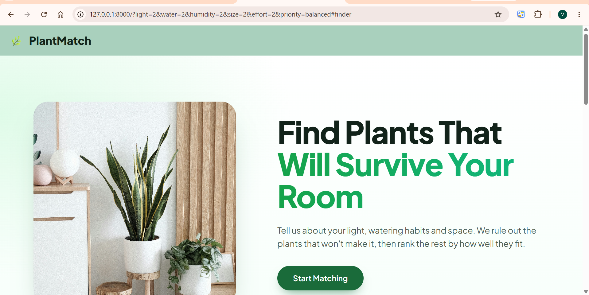
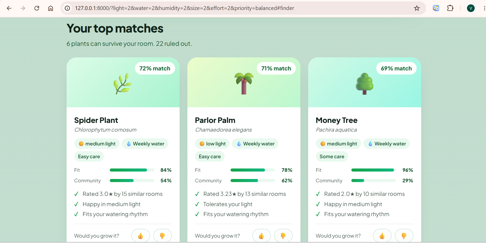
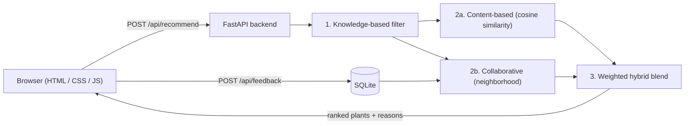

# 🌿 PlantMatch: plants that will actually survive in your room

A **hybrid recommender system** that suggests houseplants based on your light, watering habits, humidity, space and care effort. It rules out plants that would die in your room, then ranks the survivors using content-based and community (collaborative) signals, and explains every decision.

Built for the Recommender Systems course.




## How it works



| Stage | Technique                                                   | What it does                                                                                         |
| ----- | ----------------------------------------------------------- | ---------------------------------------------------------------------------------------------------- |
| 1     | **Knowledge-based (constraint) filtering**            | Hard rules remove plants that can't survive the user's conditions, and say why                       |
| 2a    | **Content-based filtering**                           | User and plants become weighted thermometer-encoded vectors, ranked by **cosine similarity**   |
| 2b    | **Collaborative filtering** (neighborhood, user-user) | Finds the k=30 users with the most similar rooms; predicts a rating from their mean-centered ratings |
| 3     | **Weighted hybrid**                                   | `final = (1 − 0.4·t)·content + 0.4·t·community`, with `t = min(1, raters/5)`                |

- **Cold start:** new users have no ratings, so neighbors are chosen by *room-profile* similarity.
- **Sparsity:** the crowd's weight shrinks when few neighbors rated a plant (falls back to content-only).
- **Feedback loop:** 👍/👎 votes are stored in SQLite and merged into the collaborative model immediately.
- **Explainability:** every card shows its Fit score, Community score and reasons; rejected plants show why.

## Run it

Requires Python 3.10+.

```bash
git clone https://github.com/vaishuuus/Plantmatch.git
cd Plantmatch/backend
python -m venv .venv
.venv\Scripts\activate          # Mac/Linux: source .venv/bin/activate
python -m pip install -r requirements.txt
python -m uvicorn main:app --reload
```

Open **http://127.0.0.1:8000**. (API docs: http://127.0.0.1:8000/docs)

## Project structure

```
Plantmatch/
├─ frontend/                 HTML, CSS, JS (served by FastAPI)
└─ backend/
   ├─ main.py                API: /api/recommend, /api/feedback, /api/stats
   ├─ db.py                  SQLite feedback store
   ├─ generate_ratings.py    creates the simulated users and ratings
   ├─ data/                  plants.csv, users.csv, ratings.csv
   └─ recommenders/          knowledge.py, content.py, collaborative.py, hybrid.py
```

## Data (please read)

`plants.csv` holds 28 houseplants with attributes on a 1–3 scale. **The 150 users and ~1,600 ratings are simulated** (`generate_ratings.py`). Each simulated user has a random room, rates plants by how well they fit, and has a hidden "taste" (succulent / leafy / classic) that the questionnaire does not capture, so the crowd carries information content-based filtering can't see. Real 👍/👎 feedback is stored separately and merged in at runtime.

## Limitations & future work

- Ratings are simulated; real user data would be needed for a true accuracy claim.
- Plant attribute values are hand-entered and should be verified (RHS, ASPCA).
- Weights (0.6/0.4, k=30) were chosen by judgment, not tuned.
- Future: matrix factorization (SVD), more plants, user accounts, seasonal/location-aware light and humidity.

**Tech:** Python · FastAPI · pandas · NumPy · scikit-learn · SQLite · HTML/CSS/JS
